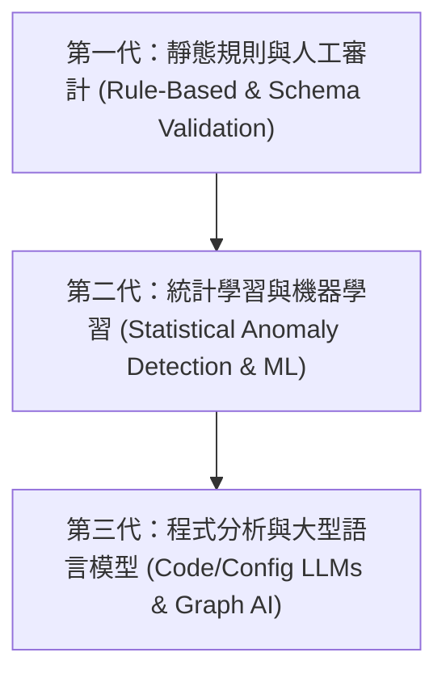

# Configuration Error Detection (配置錯誤檢測)

## 1. 概念定義與背景

**配置錯誤（Misconfiguration / Configuration Error）** 是指軟體系統在原始碼完全正確無誤的前提下，因環境變數、配置檔案（如 YAML, JSON, XML, INI）或資料庫系統參數的設定不當，導致系統運行失敗、效能劣化、安全漏洞或資料不一致的現象。

根據微軟、Google 與企業軟體研究統計，高達 20%~50% 的大規模雲端服務與企業軟體停擺事件源自於配置錯誤，而非程式碼邏輯 Bug。

---

## 2. 核心技術演進脈絡

軟體配置檢測的技術發展經歷了三個主要典範：

### 第一代：規則與綱要驗證 (Rule-based Checking)
- **手法**：透過預先定義的 Schema（如 JSON Schema, XSD）檢查型態、範圍與必填項，或撰寫靜態規則（Linter）。
- **侷限**：難以捕捉「跨模組組合矛盾」——單獨看參數 A 與參數 B 均符合規範，但兩者同時啟用時會引發交易衝突。

### 第二代：統計與機器學習分類 (Classical ML)
- **代表文獻**：[[2026-Jagadhabi-ML-SAP-Config-Errors]]
- **手法**：將系統參數轉化為特徵向量，使用 [[Random-Forest]]、[[Ensemble-Learning-for-Anomaly-Detection|集成學習]]、SVM 等演算法從歷史正常與異常狀態中學習非線性關係。
- **優勢**：能夠偵測多參數組合引發的隱蔽異常。
- **侷限**：高度依賴特徵工程、缺乏語意理解與因果可解釋性（Explainability）。

### 第三代：大型語言模型與語意推理 (LLM-based Configuration Auditing)
- **手法**：利用預訓練大型語言模型（CodeLLM）對系統文檔、配置檔案與錯誤日誌進行雙向關聯推論。
- **優勢**：能理解自然的業務語意，不僅能偵測異常，還能自動生成修復建議（Self-healing Configuration）。
- **對比分析**：詳見 [[ML-vs-LLM-for-Software-Configuration]]。

---

## 3. 跨系統挑戰 (Domain Challenges)
- **參數維度災難**：大型企業 ERP（如 SAP）或分散式系統（如 Kubernetes, Hadoop）包含數萬項參數，參數空間極大。
- **冷啟動問題**：新模組或自訂擴展（Customization）缺乏足夠的歷史標註資料。
- **多租戶與客製化變異**：不同客戶端的合法配置標準不一，缺乏通用標籤。

---

## 4. 相關連結
- [[2026-Jagadhabi-ML-SAP-Config-Errors]] - 實證檢驗機器學習於 SAP 配置檢測之應用
- [[Enterprise-Software-Analytics]] - 企業軟體分析與可觀測性
- [[ML-vs-LLM-for-Software-Configuration]] - 機器學習與大型語言模型在配置檢測之典範轉移
