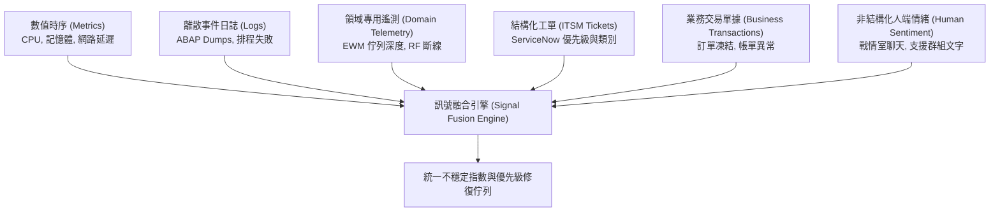

# Multi-Modal Signal Fusion in AIOps (AIOps 中的多源異質訊號融合)

## 1. 核心理念與問題背景

在複雜企業系統（如 ERP, 雲端微服務, 智慧倉儲）的維運中，傳統監控最大的瓶頸是**「資訊孤島（Information Silos）」**與**「單指標片面性」**：
- 基礎設施團隊緊盯 CPU/記憶體指標；
- 應用工程師審查錯誤日誌（Error Logs / Dumps）；
- 業務團隊只關注交易失敗單據；
- 終端用戶在即時聊天頻道發起抱怨。

**多源異質訊號融合（Multi-Modal Signal Fusion）** 主張：**沒有任何單一訊號源具有決定性的權威地位。真正的重大系統故障，在爆發之前往往以「跨訊號微弱關聯（Weak Signal Correlation）」的形式浮現。**

---

## 2. 異質訊號光譜 (Heterogeneous Signal Spectrum)

依據 [[2024-Yadavalli-Hypercare-Signal-Fusion-SAP]] 提出的架構，企業維運訊號可劃分為六大異質模態：

---

## 3. 融合管線關鍵階段

1. **時間戳校準與實體對齊 (Temporal Alignment & Entity Mapping)**：
   - 異質訊號具有不同的取樣頻率（近即時串流 vs. 事件驅動 vs. 週期性排程）。
   - 透過統一滑動視窗（Sliding Windows）與時間軸插值，將不同來源映射至同一個業務交易實體。
2. **多分支特徵萃取 (Multi-branch Feature Extraction)**：
   - **時序特徵**：滾動統計量（均值、變異數、斜率）、SARIMA 殘差與 LSTM 潛在向量。
   - **空間異常特徵**：Isolation Forest、LSTM Autoencoder 重構誤差。
   - **文字語意與情緒特徵**：利用 Transformer（如 BERT）對工單描述與聊天文字進行情感極性與急迫度評分。
3. **動態加權集成 (Dynamic Weighted Ensembling)**：
   - 使用 GBDT（Gradient Boosted Decision Trees）融合多分支輸出，並結合歷史回饋（False Positives / Confirmed Issues）動態更新權重。
4. **業務影響加權排序 (Business Impact Prioritization)**：
   - 結合層級分析法（AHP），將演算法機率轉化為可操作的「優先修復佇列（Remediation Queue）」。

---

## 4. 人端情緒（Human Sentiment）作為先導指標的重大發現

傳統 AIOps 幾乎完全排除人為文字情緒，然而實證發現：
- 終端用戶與倉庫操作員在聊天視窗中表現出的挫折感與不滿，往往**比正式建立的 ITSM 工單提前數小時**出現。
- 將非結構化人端情緒量化並納入融合管線，是大幅縮短故障發現前置時間（Lead Time）與降低平均修復時間（MTTR）的關鍵機制。

---

## 5. 相關頁面鏈接
- [[2024-Yadavalli-Hypercare-Signal-Fusion-SAP]] - 訊號融合在 SAP S/4HANA 與 EWM 上線期之實證
- [[Time-Series-Anomaly-Detection]] - 時序異常檢測演算法
- [[Ensemble-Learning-for-Anomaly-Detection]] - 集成學習異常檢測
- [[Enterprise-Software-Analytics]] - 企業軟體分析
- [[Autonomous-Enterprise-Systems-Roadmap]] - 邁向自治企業系統的演進藍圖
