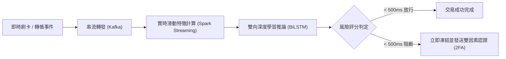

# Real-Time Financial Risk Intelligence (即時金融風控與風險智能)

## 1. 概念定義與現代金融痛點

**即時金融風控智能（Real-Time Financial Risk Intelligence）** 指的是在數位金融交易發生的幾百毫秒內（In-flight Transaction），利用串流運算與機器學習模型，即時評估交易風險、動態更新信用評分、偵測異常詐欺行為並自動觸發攔截或升級審查的能力。

### 傳統批次風控的致命缺陷 (Batch T+1 Problem)
傳統核心銀行多依賴「夜間批次作業（Nightly Batch）」進行對帳與離線風控：
- **滯後性**：受害者在清晨收到刷卡通知時，盜刷款項往往已被海外地下洗錢管道提領一空；
- **特徵靜態**：離線特徵無法捕捉「5 分鐘內在三個不同城市連續刷卡」的**交易頻次速度（Transaction Velocity）**與行為漂移。

---

## 2. 即時風控預測管線的核心機制

依據 [[2024-Gopinathan-Secure-AI-Financial-Risk-SAP]] 所構建的事件驅動即時管線：

1. **毫秒級動態特徵計算**：
   - 滑動窗口交易頻率（Velocity：過去 10 分鐘內的刷卡次數與總額度）；
   - 地理位置突變（Geo-velocity：前一次刷卡地點與目前地點的物理距離換算移動速度）；
   - 裝置指紋與帳戶餘額比例。
2. **時序感知深度學習 (BiLSTM)**：
   - 雙向長短期記憶網路（Bidirectional LSTM）能同時考慮前後交易上下文，精準捕捉異常金流軌跡。
3. **低假陽性率 (Low False-Positive Rate)**：
   - 動態特徵讓模型具備極高的精確率，大幅降低正常消費者在海外旅遊時被「誤鎖信用卡」的挫折體驗。

---

## 3. 與底層 ERP / 核心銀行的融合挑戰

金融風控模型不能獨立於帳務核心之外：
- **雙向同步**：風控模型需要 SAP S/4HANA 的客戶主檔資料（Customer Master Data），而模型輸出的詐欺判定必須秒級反饋至 SAP 核心以凍結相應會計憑證或付款指令。
- **架構原則**：採用 [[Secure-by-Design-AI|零信任原生安全架構]]，確保風控大腦與交易心臟之間的資料流通符合 PCI DSS 等嚴格法規。

---

## 4. 相關頁面鏈接
- [[2024-Gopinathan-Secure-AI-Financial-Risk-SAP]] - 來源論文
- [[Secure-by-Design-AI]] - 原生安全設計 AI 架構
- [[Time-Series-Anomaly-Detection]] - 時序異常檢測
- [[Autonomous-Enterprise-Systems-Roadmap]] - 自治企業系統演進藍圖
