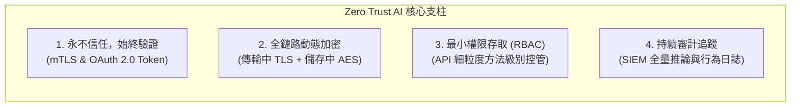

# Secure-by-Design AI Architecture (原生安全設計 AI 架構)

## 1. 核心理念：為何「事後補救」在企業級 AI 註定失敗？

在傳統軟體開發中，安全往往被當作最後一道「外掛包裝（Bolted-on）」——先完成業務代碼與模型推論，最後再套上防火牆與網路隔離。

然而，在現代涉及金融金流（銀行轉帳、信用卡詐欺）、病歷隱私與核心 ERP 資料的 AI 系統中，「事後補丁」會引發災難：
- **模型資料投毒與中途劫持**：未經加密的資料管線容易在特徵工程階段被竄改；
- **越權推論 (Inference Privilege Escalation)**：缺乏服務間雙向認證，攻擊者能偽造 API 呼叫竊取信用評分與用戶敏感資訊；
- **合規災難**：面對 PCI DSS、GDPR 與 SOX，未留存不可篡改日誌的 AI 系統無法通過外部審計。

**Secure-by-Design（原生安全設計）** 主張：**安全控制必須在架構藍圖繪製的第一天，就內嵌於資料攝取、特徵工程、模型推論至輸出反饋的每一個環節中。**

---

## 2. 零信任 (Zero Trust) 原則在 AI 管線的落地矩陣

依據 [[2024-Gopinathan-Secure-AI-Financial-Risk-SAP]] 的金融級架構，零信任落實在四大維度：

1. **雙向端點鑑別 (Mutual Authentication)**：
   微服務（如 Kafka 訊息中繼、Spark 運算叢集、BiLSTM 推論服務）之間禁止任何「預設內網信任」，全面採用基於數位憑證的 mTLS 或短期 OAuth 2.0 權杖。
2. **靜態與傳輸雙重加密 (Encryption in Transit & at Rest)**：
   交易串流全程強制 TLS 1.3，底層資料庫（如 SAP HANA）啟動儲存級加密，防止物理磁碟外洩。
3. **最小權限治理 (Least Privilege & RBAC)**：
   資料科學家、自動化微服務與外部終端僅獲取完成特定任務所需的最小資料子集，徹底隔離帳戶密碼、CVV 等極度敏感欄位。
4. **全景安全資訊日誌 (SIEM Integration)**：
   模型的每一次推論結果、特徵輸入與管理員訪問，均即時匯流至 SIEM（Security Information and Event Management），提供毫秒級異常侵入偵測與取證追溯。

---

## 3. 安全與即時效能的平衡實證

過去常有技術顧慮認為高強度安全架構會拖垮推論速度。但 [[2024-Gopinathan-Secure-AI-Financial-Risk-SAP]] 的實證打破了這一成見：
- 透過 In-Memory 記憶體資料庫（SAP HANA）與分散式串流（Kafka/Spark）的並行化優化，即使加載全套零信任鑑別與傳輸加密，**整體端到端決策延遲仍能穩定低於 500 毫秒（< 500 ms）**，兼顧了軍規級安全與亞秒級金融交易體驗。

---

## 4. 相關頁面鏈接
- [[2024-Gopinathan-Secure-AI-Financial-Risk-SAP]] - 來源論文
- [[Real-Time-Financial-Risk-Intelligence]] - 即時金融風控與詐欺預測
- [[Autonomous-Enterprise-Systems-Roadmap]] - 自治企業系統演進藍圖
- [[Enterprise-Software-Analytics]] - 企業軟體分析
