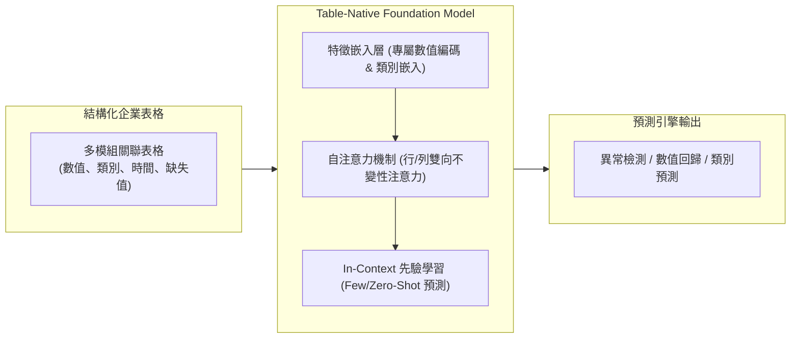

# Tabular Data Foundation Models (表格式資料基礎模型)

## 1. 核心困局：為何通用 LLM 在表格資料上碰壁？

大型語言模型（LLM，如 GPT-4, Llama-3, DeepSeek-V3）在自然語言、程式碼生成與多模態推理上表現極為卓越，但在**企業核心的結構化表格式資料（Tabular Data）**上，通用 LLM 的預測能力卻屢遭挫折。

> [!WARNING] 關鍵實證數據：通用 LLM 的表格赤字
> 依據 [[2024-Narne-Generative-AI-SAP-Data-Management]] 的實證結論：
> **最先進的通用 LLM（SOTA LLMs）在結構化商業資料的分類、回歸與數值預測任務中，其準確率比既有的專門機器學習模型（如 GBDT, Random Forest）落後整整 20% 至 50%。**

### 根本原因剖析：
1. **數值語意與 Tokenization 障礙**：BPE 分詞器將連續數值拆成不連貫的子詞元（Subwords），破壞了數值大小、尺度與數學連續性。
2. **排列不變性（Permutation Invariance）的缺失**：在關聯資料表中，列的順序與行的排列本應具有對稱性，但自回歸 Transformer 具有強烈的由左至右順序偏差（Positional Bias）。
3. **特徵高度異質性與稀疏性**：表格資料同時混雜連續浮點數、高基數離散類別（High-cardinality Categorical）、日期時間與空值，缺乏自然語言那樣平滑的語意流。

---

## 2. 表格式原生基礎模型 (Table-Native Foundation Models) 的崛起

為了解決上述缺陷，業界與學界（如 SAP 研發的 **SAP Foundation Model** 以及學界 TabPFN、TabNet 等）發展出專為表格設計的原生基礎模型：

### 核心能力與特徵：
- **無需額外訓練資料的預測能力 (Zero-shot / In-Context Prediction)**：模型在大量合成表格或先驗函數空間預訓練，輸入新表格與少量樣本即可自動完成高品質推論。
- **可擴展性（Scaling Laws on Tabular Data）**：如同 [[2024-Narne-Generative-AI-SAP-Data-Management]] 的實驗所示，隨資料量增加（100MB 至 10,000MB），表格式基礎模型準確率從 88% 擴展至 96%，而傳統方法在 75% 處即達到極限。
- **高吞吐與低延遲**：相比於動輒數秒的通用 LLM API 呼叫，專用表格式基礎模型的推論延遲可壓至 100~240 毫秒，吞吐量達到每秒近萬筆。

---

## 3. 與通用 LLM 之分工與互補

在現代企業 AI 架構中，兩者呈現明確的分工格局：
- **Table-Native Foundation Models**：負責「數值計算、機率密度估計、異常分類與趨勢回歸」。
- **Generic LLMs (如 [[SAP-Joule]])**：負責「查詢意圖理解、商業情境說明、跨模組編排與自動生成自然語言報告」。

---

## 4. 相關頁面鏈接
- [[2024-Narne-Generative-AI-SAP-Data-Management]] - 表格式基礎模型在 SAP 之實證評測
- [[SAP-Joule]] - 企業級生成式 AI Copilot
- [[ML-vs-LLM-for-Software-Configuration]] - 機器學習 vs LLM 在軟體配置領域的典範對比
- [[Configuration-Error-Detection]] - 配置錯誤檢測
