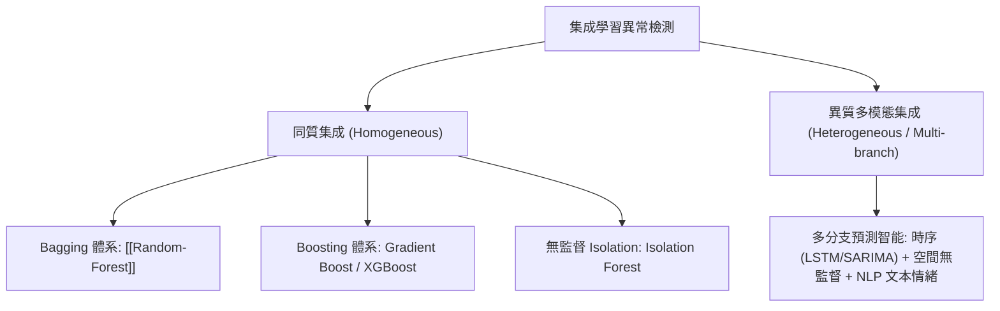

# Ensemble Learning for Anomaly Detection (集成學習於異常檢測)

## 1. 概述

**Ensemble Learning（集成學習）** 是透過組合多個弱學習器（Weak Learners）以構建強學習器（Strong Learner）的機器學習範式。在異常檢測（Anomaly Detection）與軟體可靠性分析中，單一模型往往容易受到局部資料雜訊干擾或在複雜邊界上發生過擬合，因此集成方法（Bagging, Boosting, Stacking）被廣泛採用。

---

## 2. 主流方法分類

1. **Bagging 體系**：
   - 代表：[[Random-Forest]]。
   - 特色：平行構建相互獨立的樹模型，擅長降低預測的變異數（Variance），對離群值與雜訊具有強健抵抗力。
2. **Boosting 體系**：
   - 代表：Gradient Boosting (GBDT), XGBoost。
   - 特色：序列式訓練，後續基學習器重點擬合前序模型的預測殘差（Residuals），能逼近高度複雜的非線性邊界。
3. **異質多模態集成 (Multi-Branch Heterogeneous Ensemble)**：
   - 代表架構：[[2024-Yadavalli-Hypercare-Signal-Fusion-SAP]] 提出的 Hypercare Signal Fusion (HSF)。
   - 特色：單一模型或單一資料形態無法全面表徵複雜系統狀態。透過不同分支分別提取異常空間特徵（Isolation Forest / LSTM Autoencoder）、時序趨勢（SARIMA / LSTM）與文字情緒（BERT），最後利用 GBDT 或 Stacking 統合輸出最終升級機率。

---

## 3. 在軟體與配置監控中的實證表現

- **參數配置檢測**（[[2026-Jagadhabi-ML-SAP-Config-Errors]]）：集成樹模型（[[Random-Forest]] 0.93 Accuracy, Gradient Boost 0.92 Accuracy）顯著優於單一決策樹（0.89 Accuracy），能有效捕捉跨模組非線性約束。
- **上線期系統不穩定檢測**（[[2024-Yadavalli-Hypercare-Signal-Fusion-SAP]]）：
  - 單一規則：F1 = 0.48
  - 單一 Isolation Forest：F1 = 0.64
  - 單一 LSTM Autoencoder：F1 = 0.68
  - **多分支異質集成 (HSF Ensemble)**：**F1 = 0.81**（大幅領先單一模型 13~17 個百分點）。

---

## 4. 相關連結
- [[Random-Forest]] - 隨機森林演算法
- [[Time-Series-Anomaly-Detection]] - 時序異常檢測演算法
- [[Multi-Modal-Signal-Fusion-AIOps]] - 多源訊號融合架構
- [[Configuration-Error-Detection]] - 配置錯誤檢測
- [[Enterprise-Software-Analytics]] - 企業軟體分析
