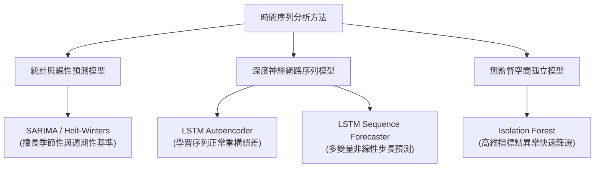

# Time-Series Anomaly Detection (時間序列異常檢測)

## 1. 原理與目標

**Time-Series Anomaly Detection（時間序列異常檢測）** 旨在從連續時間步長觀測到的變數序列中，找出偏離預期正常模式（Normal Pattern）的異常點（Point Anomalies）、情境異常（Contextual Anomalies）或子序列模式（Collective Anomalies）。在 AIOps 與企業軟體維運中，時序分析是判斷伺服器負載漂移、網路擁塞與排程延遲的核心工具。

---

## 2. 經典演算法家族與互補性

在實務架構（如 [[2024-Yadavalli-Hypercare-Signal-Fusion-SAP]]）中，單一模型往往難以兼顧週期規律與突發非線性依賴，因此通常結合統計模型與深度神經網路：

### 1. 統計模型：SARIMA 與指數平滑 (Holt-Winters)
- **原理**：將序列分解為趨勢（Trend）、季節性（Seasonality）與殘差（Residual）。
- **優勢**：可解釋性極高，對於具有強週期性的指標（如每日定時批次排程、夜間結帳尖峰）能給出穩固的基準預測線。
- **指標殘差作為異常特徵**：真實觀測值與 SARIMA 預測值之間的殘差（Prediction Residuals）直接作為第二階段異常分類器的輸入特徵。

### 2. 深度學習：LSTM Autoencoder (長短期記憶自動編碼器)
- **原理**：利用 LSTM 的循環單元記憶時序依賴，將輸入序列壓縮至低維潛在空間（Encoder），再嘗試重構回原始序列（Decoder）。
- **異常判定準則**：模型在正常行為資料上訓練，當遇到從未見過的異常模式時，其**重構誤差（Reconstruction Error）**將急劇上升，以此作為異常程度的評分標準。

### 3. 多變量時序預測：LSTM Forecaster
- **原理**：輸入前 $k$ 步的多維遙測特徵（如 CPU %、記憶體使用率、佇列長度），預測未來 $t+\Delta t$ 時刻的數值走勢。
- **優勢**：具備「預測性告警（Predictive Alerting）」能力，能夠在指標真正衝破危險閾值前數十分鐘提前觸發處置流程。

---

## 3. 在多源訊號融合中的定位

依據 [[2024-Yadavalli-Hypercare-Signal-Fusion-SAP]] 的實驗數據：
- 單獨使用 LSTM Autoencoder 僅能達到 F1-Score **0.68**；
- 若將時序預測殘差與 [[Multi-Modal-Signal-Fusion-AIOps|文字情緒及空間異常]] 進行集成融合，F1-Score 躍升至 **0.81**。
- 這證明時序模型在現代 AIOps 中最合適的角色是作為**「特徵提取器（Feature Extractor）」**，而非孤立的決策終點。

---

## 4. 相關頁面鏈接
- [[Multi-Modal-Signal-Fusion-AIOps]] - 多源訊號融合架構
- [[Ensemble-Learning-for-Anomaly-Detection]] - 集成學習異常檢測
- [[Enterprise-Software-Analytics]] - 企業軟體分析
- [[2024-Yadavalli-Hypercare-Signal-Fusion-SAP]] - 來源文獻
