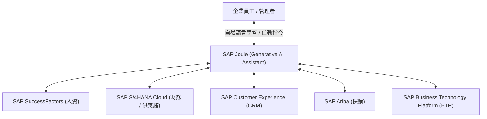

# SAP Joule: Enterprise Generative AI Copilot

## 1. 模型定位與發布背景

**Joule** 是 SAP 於 2023 年第三季度推出的全企業級生成式人工智慧（Generative AI）自然語言助理與 Copilot。不同於一般的聊天機器人，Joule 直接深植於 SAP 的業務架構核心，具備跨系統檢索企業即時情境、理解複雜業務實體（如物料代碼、會計科目、組織架構）與執行跨模組調度的能力。

---

## 2. 核心架構與技術特性

1. **情境感知語意推理 (Context-Aware Semantic Reasoning)**：
   - 能夠連結 SAP 關聯資料庫與中繼資料（Metadata），在遵循嚴格企業權限的前提下，直接存取 ERP 交易數據回答「哪條生產線下週可能因缺料停產？」等深層洞察。
2. **多模組統一自然語言介面**：
   - 解決以往 ERP 介面選單層次繁多、使用者必須熟記代碼（T-Code）的高昂學習成本。
3. **安全與合規防線 (Business AI Trust)**：
   - 強調資料不會被用於公開模型二次訓練，並符合 GDPR 等法規，內建防止資料外洩與隱私防護機制。

---

## 3. 在企業智慧演進（Three Horizons）中的角色

依據 [[2025-Sharma-Intelligent-Systems-SAP]] 的劃分，Joule 處於從 **Horizon 2（擴展智慧）向 Horizon 3（自治企業系統）** 邁進的關鍵載體：
- 過去的對話機器人（如 SAP Conversational AI）主要依賴意圖樹（Intent Trees）與固定槽位填充（Slot Filling）。
- Joule 代表由通用大語言模型（LLM）驅動的全新典範，具備自主意圖規劃、多步驟工具調用（Tool Calling / Function Calling）與長上下文理解能力。

---

## 4. 局限性與挑戰
- **結構化數值運算限制**：正如 [[2024-Narne-Generative-AI-SAP-Data-Management]] 所指出，純語言模型在處理大規模結構化表格時容易出現數值幻覺或低預測精度，需要與底層 [[Tabular-Data-Foundation-Models|表格式專用模型]] 與 HANA 資料庫緊密整合。
- **自定義與客製化程式碼相容性**：不同企業大量客製化的 ABAP 代碼與自建 Z-Table 對 Joule 提出極高的微調與 RAG 適配挑戰。

---

## 5. 相關頁面鏈接
- [[2025-Sharma-Intelligent-Systems-SAP]] - 智慧系統與 SAP 整合綜述
- [[Tabular-Data-Foundation-Models]] - 表格式資料基礎模型
- [[Autonomous-Enterprise-Systems-Roadmap]] - 邁向自治企業系統的演進藍圖
- [[ML-vs-LLM-for-Software-Configuration]] - 機器學習 vs LLM 在軟體配置領域的對比
