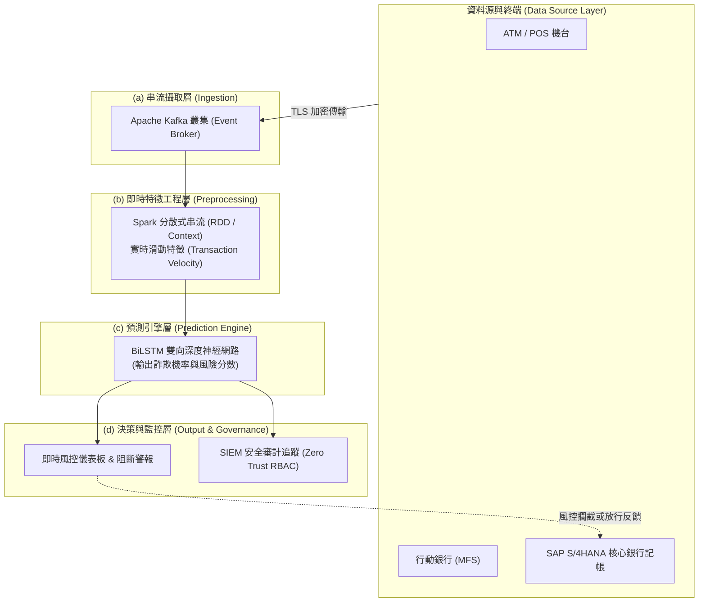

# Real-Time Financial Risk Intelligence Using Secure-by-Design AI in SAP-Enabled Cloud Digital Banking

> **文獻資訊**
> - **作者 (Author)**: Vimal Raja Gopinathan (Senior Principal Consultant, Oracle Financial Service Software Ltd, Washington, USA)
> - **期刊**: *International Journal of Computer Technology and Electronics Communication (IJCTEC)*, Vol. 7, Issue 6, pp. 9837–9845, Nov-Dec 2024
> - **DOI**: [10.15680/IJCTECE.2024.0706017](https://doi.org/10.15680/IJCTECE.2024.0706017)
> - **收錄日期**: 2026-11-23

---

## 1. 核心貢獻與摘要 (Core Contributions)

現代數位銀行（Digital Banking）對即時交易風控、詐欺偵測（Fraud Detection）與動態信用評分的要求極高。然而，許多銀行的核心記帳底層依然依賴 SAP（如 SAP ECC 或 S/4HANA），這類系統歷史上設計偏向批次處理（Batch Processing）與人工工作流，且未原生針對現代雲端微服務等級的低延遲預測而設計。此外，金融資料面臨 PCI DSS、GDPR、SOX 等極嚴格法規監管，傳統「事後加裝（Bolted-on）防火牆」的作法極易滋生漏洞。

**核心貢獻**：
1. **提出 Secure-by-Design（原生安全設計）金融 AI 架構**：打破事後修補安全的思維，將零信任（Zero Trust）存取控制、端到端 TLS 傳輸加密、HANA 靜態資料加密與最小權限原則（Least Privilege）原生嵌入每一層管線。
2. **事件驅動的即時串流資料管線 (Event-driven Streaming Pipeline)**：結合 SAP Event Mesh / CPI 與 Apache Kafka，將交易事件轉化為即時串流，配合 Spark 分散式特徵工程（計算交易頻率 Velocity、行為漂移）。
3. **低延遲預測引擎 (BiLSTM Deep Learning Engine)**：採用雙向長短期記憶網路（Bidirectional LSTM），在交易發生瞬間預測異常機率與詐欺分數（Fraud Score）。
4. **實證驗證端到端低於 500 毫秒極速反應**：在原型驗證中，從交易事件觸發、特徵運算到模型推論與風控決策輸出，延遲**穩定控制在 500 毫秒（< 500 ms）以內**，兼具線性擴展性與滲透測試零被突破之高安全姿態。

---

## 2. 系統架構與資料流 (Figure 1)

---

## 3. 重要實證數據與核心發現

### A. 關鍵效能指標 (Performance Metrics)
* **端到端延遲 (End-to-End Latency)**：**< 500 ms**（完全滿足信用卡刷卡與即時轉帳的授權等待閾值）。
* **預測準確度 (Predictive Accuracy)**：全面超越傳統夜間批次（Batch）模型。由於能夠在推論當下取得最新毫秒級的交易頻率（Transaction Velocity）與情境特徵，大幅降低了誤報率（False-Positive Rate），減少合法用戶被誤擋的困擾。
* **安全姿態 (Security Posture)**：通過全套滲透測試（Penetration Testing）與弱點掃描，在強制雙向認證（mTLS / OAuth 2.0 Token）下無任何越權存取成功。
* **線性擴展力 (Scalability)**：Kafka 訊息佇列與容器化微服務隨交易量增長呈現線性吞吐擴展，尖峰壓力下 CPU/記憶體維持於安全閾值。

---

## 4. 批判性思考與研究限制 (Strengths & Limitations)

### 優勢 (Strengths)
- **破除安全與效能的二元對立**：傳統觀念常認為「加密與權限檢查會嚴重拖慢交易速度」，本篇透過 HANA In-Memory + 記憶體內微服務證明：在優化架構下，高強度零信任安全與 <500ms 極速推論可同時達成。
- **直面金融合規生命線**：在架構初期即納入 PCI DSS、GDPR 與 SOX 要求，具備完善的 SIEM 審計追蹤日誌（Audit Trail）。

### 限制 (Limitations)
- **缺乏黑天鵝極端行情壓力測試**：評測偏向典型銀行交易負載，未針對類似高頻交易擠兌或分散式阻斷攻擊（DDoS）混雜海量異常交易的極限狀況給出崩潰邊界。
- **模型可解釋性 (XAI) 尚未完全閉環**：BiLSTM 深度神經網路相較於樹模型仍偏向黑盒，雖在未來工作提及特徵歸因（Feature Attribution），但論文中尚未整合即時 SHAP / LIME 解釋模組以滿足金融監管對「拒絕貸款或拒絕交易之理由說明」的嚴格要求。

---

## 5. 相關頁面鏈接
- [[Secure-by-Design-AI]] - 原生安全設計與零信任 AI 架構
- [[Real-Time-Financial-Risk-Intelligence]] - 即時金融風控與詐欺預測
- [[Enterprise-Software-Analytics]] - 企業軟體分析與智能維運
- [[Autonomous-Enterprise-Systems-Roadmap]] - 自治企業系統演進藍圖
- [[Tabular-Data-Foundation-Models]] - 表格式資料基礎模型
