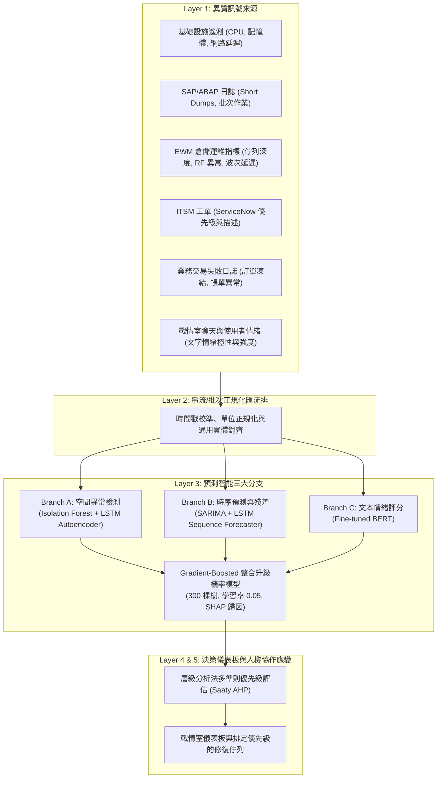

# Hypercare Signal Fusion for Early Instability Detection in SAP S/4HANA and EWM Go-Lives

> **文獻資訊**
> - **作者 (Author)**: Venkata Rao Yadavalli (MYGO Consulting Inc, USA)
> - **期刊**: *International Journal of Research Publications in Engineering, Technology and Management (IJRPETM)*, Vol. 7, Issue 5, pp. 11384–11396, Sept-Oct 2024
> - **DOI**: [10.15662/IJRPETM.2024.0705024](https://doi.org/10.15662/IJRPETM.2024.0705024)
> - **收錄日期**: 2026-11-23

---

## 1. 核心貢獻與摘要 (Core Contributions)

在企業 ERP 轉型中，系統剛上線後的「高護期（Hypercare Phase）」是決定專案成敗的最脆弱窗口。尤其是導入 SAP S/4HANA 搭配延伸倉儲管理（EWM）時，實體物流對延遲極度敏感（如 RF 手持設備斷線或波次發放排隊過長會迅速導致出貨中斷）。傳統 IT 運維各部門（基礎設施團隊、Basis 團隊、業務模組團隊）各自使用孤立的儀表板，只能在使用者抱怨或交易失敗後進行被動式排查（Reactive Triage）。

**核心貢獻**：
1. **提出 Hypercare Signal Fusion (HSF) 五層參考架構**：將企業系統上線期的不穩定性檢測轉化為「多源異質訊號融合與預測性智能問題」。
2. **多模態六大訊號源融合**：
   - 基礎設施遙測（CPU, Memory, Network latency）
   - SAP 系統與應用日誌（ABAP Short Dumps, Background Jobs）
   - 專用監控（EWA, Focused Run）
   - EWM 倉儲運維指標（佇列深度、RF 設備異常、波次延遲）
   - ITSM 事件工單（ServiceNow 工單文字、優先級）
   - 業務交易失敗與**使用者情緒（User Sentiment）**（戰情室對話紀錄、意見回饋）。
3. **三分支混合預測智能管線 (Three-branch Predictive Intelligence Pipeline)**：
   - **Branch A (異常檢測)**：Isolation Forest + LSTM Autoencoder 結合。
   - **Branch B (時間序列預測)**：SARIMA + LSTM Sequence Forecaster 捕捉週期與非線性殘差。
   - **Branch C (文字情緒評分)**：以 Transformer (BERT 家族) 提取工單與即時通訊中之恐慌/負面情緒訊號（作為早期領先指標）。
   - **綜合集成**：使用 Gradient-Boosted 模型綜合三分支，輸出具有可解釋性（SHAP-style attribution）的升級機率。
4. **決策支援層 (Decision Support Layer)**：整合 Analytic Hierarchy Process (AHP)，依據預測故障機率、業務衝擊權重與預估修復工時，動態生成排定優先級的修復佇列。

---

## 2. HSF 系統架構與資料流

---

## 3. 特徵工程與模型超參數規格 (Table 2 & Table 3)

### A. 訊號分類與特徵提取架構 (Table 2)
| 訊號類別 (Signal Category) | 原始欄位 (Raw Fields) | 提取特徵類型 (Extracted Feature Type) | 融合角色 (Fusion Role) |
| :--- | :--- | :--- | :--- |
| **基礎設施遙測** | CPU %, 記憶體 %, 磁碟 I/O, 網路延遲 | 滑動視窗統計量（均值、變異數、斜率） | 技術先導異常偵測 |
| **SAP / EWM 日誌** | Short Dumps, 作業狀態, 佇列深度, RF 錯誤 | 事件發生率（Event-rate）與類別編碼 | SAP 領域專有異常定位 |
| **ITSM 工單** | 優先級、類別、自由文字描述 | Transformer 文本嵌入向量（Embedding）+ 元數據 | 已確認故障之關聯分析 |
| **業務交易失敗** | 訂單凍結、開立發票錯誤、交貨異常 | 業務流程維度之事件發生率 | 業務影響程度評估 |
| **人端使用者情緒** | 滿意度調查、聊天室對話、戰情室紀錄 | 情緒極性（Polarity）與情緒強度評分 | **早期質化困窘預警訊號** |

### B. 預測智能子系統模型超參數設定 (Table 3)
* **Branch A (Detector 1 - Isolation Forest)**：
  - 參數：`n_estimators = 200`, `contamination = 0.03`
  - 理由：高維稀疏資料下具備極佳計算效率與抗噪能力。
* **Branch A (Detector 2 - LSTM Autoencoder)**：
  - 參數：2 層 LSTM，每層 64 隱藏單元，滑動視窗 `window = 60 steps`
  - 理由：捕捉正常時序依賴結構，利用重構誤差（Reconstruction Error）標定時序偏離。
* **Branch B (Forecaster 1 - SARIMA)**：
  - 參數：依據 AIC 準則為每個指標序列自動網格搜尋擬合 $(p,d,q)(P,D,Q)_s$
  - 理由：針對具備明確日/週週期性（如夜間結帳排程）之指標提供高可解釋性基準。
* **Branch B (Forecaster 2 - LSTM Sequence Forecaster)**：
  - 參數：2 層 LSTM，每層 64 單元，預測前瞻步長 `horizon = 30 min`
  - 理由：預測非線性多變量相互依賴之未來趨勢。
* **Branch C (Sentiment Classifier - BERT-family)**：
  - 參數：在 Hypercare 與 ITSM 專屬文本語料庫上進行微調（Fine-tuned）
  - 理由：精確捕捉 IT 維運場景下的專有名詞與員工焦慮/負面情緒強度。
* **融合決策模型 (Fusion Escalation Model - GBDT)**：
  - 參數：300 棵決策樹，最大深度 `max_depth = 6`，學習率 `learning_rate = 0.05`
  - 理由：在異質表格特徵上表現強健，且支援 SHAP 特徵貢獻度歸因（SHAP-style attribution），打破黑盒疑慮。

---

## 4. 決策支援與層級分析法優先級排程 (Section VIII)

HSF 不僅停留在輸出「異常機率」，其第 4 層（Decision Support）透過 Saaty (1980) 的**層級分析法（Analytic Hierarchy Process, AHP）**計算多準則綜合優先分數：

$$\text{Priority Score} = f\Big(P_{\text{escalation}}, \, W_{\text{business\_impact}}, \, E_{\text{remediation\_effort}}\Big)$$

1. **升級機率 ($P_{\text{escalation}}$)**：由 GBDT 融合模型輸出的故障擴大機率。
2. **業務衝擊權重 ($W_{\text{business\_impact}}$)**：在系統切換（Cutover）計畫中預先定義的各模組關鍵度（如 EWM 出貨阻塞的衝擊權重遠高於內部費用報銷）。
3. **預估修復工時 ($E_{\text{remediation\_effort}}$)**：排查與套用 Patch 所需之技術資源。

戰情室儀表板依此動態排序修復佇列（Remediation Queue），確保有限的專家資源優先投入「後果最嚴重且最急迫」的故障點。

---

## 5. 重要實證數據（模擬實驗對比）

論文建構了模擬 42 天 Hypercare 運維場景之資料集，評測各檢測配置表現：

| 檢測器配置 (Detector Configuration) | Precision | Recall | F1-Score | 特性說明 |
| :--- | :---: | :---: | :---: | :--- |
| 傳統靜態閾值規則 (Rule-based Threshold) | 0.51 | 0.46 | 0.48 | 單指標獨立告警，無跨訊號關聯 |
| 單一 Isolation Forest 模型 | 0.68 | 0.61 | 0.64 | 單一檢測器，無時序預測與情緒訊號 |
| 單一 LSTM Autoencoder | 0.71 | 0.66 | 0.68 | 捕捉時間依賴結構，但缺乏多樣性 |
| **HSF Ensemble (本論文提出架構)** | **0.84** | **0.79** | **0.81** | **融合異常檢測、時序預測與 BERT 文本情緒** |

### 核心發現：
- **微弱訊號關聯 (Weak Signal Correlation)**：單一指標（如 HANA 記憶體輕微波動）不會引發告警，但當其與「EWM 波次釋放延遲上升」及「倉儲頻道聊天情緒轉負」同時共現時，HSF 能在嚴重故障發生前數小時發出高信心預警。
- **維運模式典範移轉**：使 Hypercare 團隊從第一週高達 80% 的被動救火（Reactive Triage），在第六週成功轉為以主動修復（Proactive Remediation）為主。

---

## 6. 批判性思考與研究限制 (Strengths & Limitations)

### 優勢 (Strengths)
- **跨越 IT 孤島與將「情緒指標」量化納入 AIOps**：首度在 ERP AIOps 文獻中將工單語音/聊天文字（Human Sentiment）作為領先預警指標，而非僅監控伺服器指標。
- **閉環決策支援設計**：不僅做 Anomaly Detection，還結合 AHP 與業務衝擊矩陣，輸出可執行的修復順序。

### 限制 (Limitations)
- **基於合成模擬數據 (Simulation-based Evaluation)**：由於取得實際企業 S/4HANA 上線期的高敏感性日誌難度極高，論文之實驗為數值模擬，尚未在真實生產環境完成驗證。
- **缺乏消融實驗 (Ablation Study)**：未單獨量化文字情緒分支（Branch C）或時序分支（Branch B）對整體 F1-score (0.81) 的獨立邊際貢獻度。

---

## 7. 相關頁面鏈接
- [[Enterprise-Software-Analytics]] - 企業軟體分析
- [[Multi-Modal-Signal-Fusion-AIOps]] - 多源異質訊號融合在 AIOps 的實踐
- [[Time-Series-Anomaly-Detection]] - 時序異常檢測與預測演算法
- [[Ensemble-Learning-for-Anomaly-Detection]] - 集成學習異常檢測
- [[Autonomous-Enterprise-Systems-Roadmap]] - 自治企業系統演進藍圖
