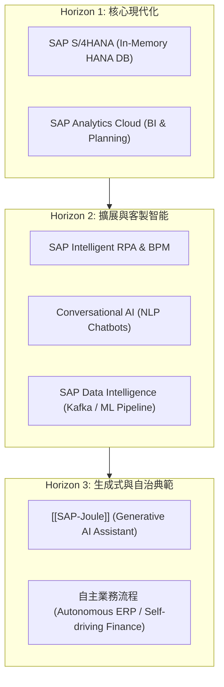

# The Convergence of Intelligent Systems and SAP Solutions: Shaping the Future of Enterprise Resource Planning

> **文獻資訊**
> - **作者 (Authors)**: Chetan Sharma (Tractor Supply Company, USA), Rohini Sharma (Deloitte Consulting, USA), Kavita Sharma (Government Polytechnic College Kota, India)
> - **出版出處**: *Advancements in Intelligent Systems*, pp. 71–93, SCRS, India, 2025
> - **DOI**: [10.56155/978-81-975670-3-2-6](https://doi.org/10.56155/978-81-975670-3-2-6)
> - **收錄日期**: 2026-11-23

---

## 1. 核心貢獻與摘要 (Core Contributions)

本篇論文為綜述研究，系統性盤點了人工智慧（AI）、機器學習（ML）、自然語言處理（NLP）、機器人流程自動化（RPA）與物聯網（IoT）全面融入現代企業資源規劃（ERP）巨頭 SAP 生態系的技術全景。

**核心貢獻**：
1. **確立智慧 ERP 的三個探索地平線 (Three Horizons for Intelligent ERP)**：
   - **Horizon 1 (成熟基礎)**：以 SAP S/4HANA 為核心，內建預先定義的數位技術與高價值業務案例（>100 個立即可用的情境）。
   - **Horizon 2 (擴展整合)**：企業自主構建機器學習模型或自訂 RPA Bots，透過 SAP Fiori 與微服務無縫嵌入工作流程。
   - **Horizon 3 (未來典範：自治 ERP)**：探索自主化財務（Autonomous Financial Systems）與無人化業務流程，推動向全自主企業（Autonomous Enterprise）轉型。
2. **全面解構 SAP 智慧技術產品矩陣**：
   - **[[SAP-Joule]]**：2023 年 Q3 推出的生成式 AI 自然語言助手，跨越 SuccessFactors、S/4HANA Cloud、Ariba 與 BTP。
   - **SAP Leonardo**：整合 IoT、區塊鏈、大數據分析與機器學習的數位創新平台。
   - **SAP Conversational AI & IRPA**：結合對話機器人引擎與端到端智慧流程自動化（BPM + RPA）。
   - **SAP Data Intelligence**：分散式資料資產治理、Kafka 串流與 ML Pipeline 調度平台。
3. **辨識企業落地 AI 的核心挑戰框架**：指出資料安全與隱私、異質資料品質與相容性、組織變革管理（Change Management）、資本投資報酬（ROI）與即時延遲擴展性等五大瓶頸。

---

## 2. 智慧 ERP 的演進架構與產品矩陣

---

## 3. 重要觀點與實證洞察

1. **記憶體資料庫（In-Memory）為智能即時化的算力基石**：傳統磁碟型資料庫無法支援高頻即時推論，S/4HANA 的 HANA In-Memory 架構是將預測模型嵌入交易層（OLTP + OLAP 混合）的前提。
2. **多模態互動與自然語言轉向**：員工不再需要死記複雜的 SAP 交易代碼（T-Code），透過自然語言生成助手（如 [[SAP-Joule]]）即可完成採購審批、休假申請與即時財務報表查詢。
3. **人機協作過渡期的變革風險**：技術引進的最大阻力常非演算法本身，而是組織對透明度、決策解釋性與工作流程重組的接受度。

---

## 4. 批判性思考與研究限制 (Strengths & Limitations)

### 優勢 (Strengths)
- **架構視野宏觀且分類清晰**：完整梳理了從傳統 SAP R/3 到現代 S/4HANA Cloud 與生成式 AI 的演進軌跡。
- **產業與諮詢實務視角**：作者來自企業實務與諮詢顧問端，精確捕捉了導入 AI 時的非技術瓶頸（隱私、成本與文化變革）。

### 限制 (Limitations)
- **偏向架構盤點，缺乏量化實驗數據**：本篇屬於定性綜述與產業報告，未提供特定模型在 SAP 基準上的準確率（F1-Score）或延遲等硬指標。
- **對開源與非 SAP 原生生態涉及較少**：主要聚焦於 SAP 官方產品線（Joule, Leonardo, SAC），未深入探討如何與開源 LLM（如 Llama, DeepSeek）或自建 RAG 架構進行混合部署。

---

## 5. 與本知識庫之關聯與延伸思考
- 與 [[2026-Jagadhabi-ML-SAP-Config-Errors]] 互相呼應：Jagadhabi 解決的是底層「配置錯誤」，而 Sharma 展現了上層「業務與智慧流程集成」的全貌。
- 關聯頁面：
  - [[SAP-Joule]] - SAP 生成式 AI 自然語言助手專頁
  - [[Autonomous-Enterprise-Systems-Roadmap]] - 自治企業系統演進藍圖
  - [[Enterprise-Software-Analytics]] - 企業軟體分析與可觀測性
