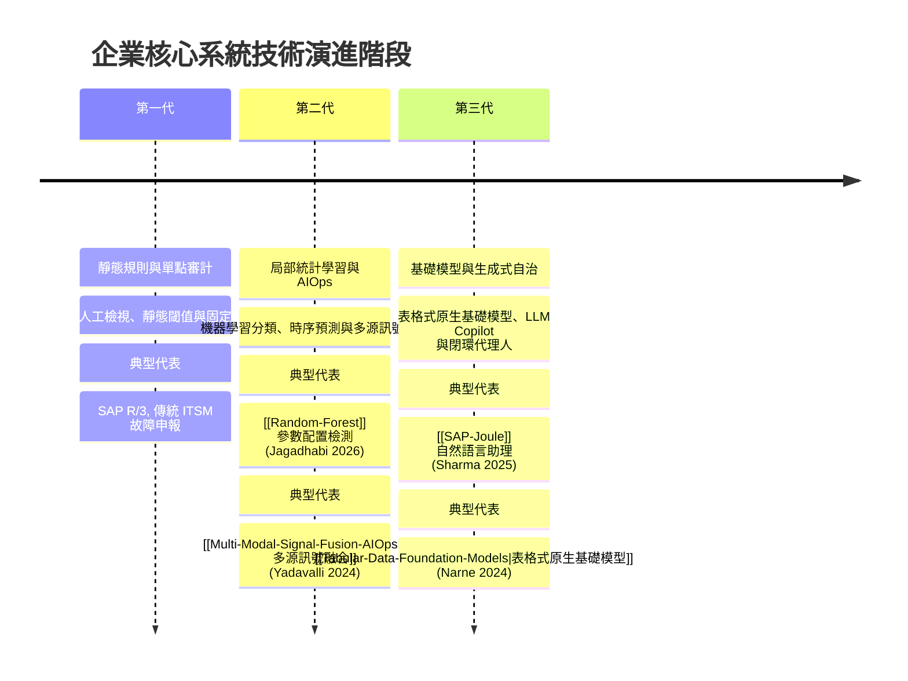
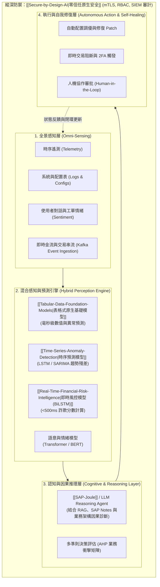

# Autonomous Enterprise Systems: 從 AIOps 到生成式 AI 的演進藍圖

## 1. 綜述背景與核心問題

現代大型企業核心系統（如 SAP S/4HANA、供應鏈與金融金流網絡）正面臨複雜度的極限。從傳統的人工審計、靜態規則檢測，到機器學習驅動的 AIOps，再到零信任原生安全防護，最終邁向自主感知、自我推理與自我修復的**「自治企業（Autonomous Enterprise）」**，是當前產學界共同聚焦的技術演進核心。

本篇綜述彙整本知識庫已收錄之五篇關鍵文獻，梳理出企業智慧系統的演進階段、安全防線與未來關鍵架構。

---

## 2. 三代演進階梯：從靜態規則到自主決策

### 階段一：單點問題的機器學習求解 (Point Solution)
- **代表文獻**：[[2026-Jagadhabi-ML-SAP-Config-Errors]]
- **核心特徵**：針對 ERP 系統中的特定瓶頸（如跨模組參數配置衝突），採用傳統監督式學習（如 [[Random-Forest]]）取代靜態規則，以 0.93 的準確率證明非線性演算法能有效捕捉參數間的隱性約束。

### 階段二：跨系統多源異質訊號融合 (Systemic Signal Fusion)
- **代表文獻**：[[2024-Yadavalli-Hypercare-Signal-Fusion-SAP]]
- **核心特徵**：認識到單一指標不足以預防系統停擺，打破 IT 監控孤島。整合基礎設施遙測、應用日誌、專用指標、ITSM 工單與**戰情室使用者非結構化情緒**，透過異質集成管線（Isolation Forest + LSTM + SARIMA + BERT）實現從被動救火（Reactive Triage）到主動修復（Proactive Remediation）的轉變。

### 階段三：生成式基礎模型與自治企業閉環 (Foundation Models & Autonomous Loop)
- **代表文獻**：[[2025-Sharma-Intelligent-Systems-SAP]]、[[2024-Narne-Generative-AI-SAP-Data-Management]]、[[2024-Gopinathan-Secure-AI-Financial-Risk-SAP]]
- **核心特徵**：邁向「第三地平線（Horizon 3：自主流程）」。
  1. 透過自然語言 Copilot（[[SAP-Joule]]）降低業務門檻；
  2. 發展針對結構化表格的 [[Tabular-Data-Foundation-Models|表格式原生基礎模型]]，解決通用 LLM 在商業數值預測上落後 20%~50% 的瓶頸；
  3. 引進 [[Secure-by-Design-AI|零信任原生安全 (Secure-by-Design)]] 與 [[Real-Time-Financial-Risk-Intelligence|即時金融風控串流]]，在交易發生的 500 毫秒內（<500ms）完成動態風險計算與詐欺防堵，築牢自治系統的金流生命線。

---

## 3. 未來自治企業架構的核心拼圖

綜合各文獻的研究洞察，未來自治 ERP 系統的標準參考架構應包含四層閉環，並由縱貫全局的「零信任原生安全」所防護：

---

## 4. 關鍵技術權衡與治理防線

推動自治企業系統落地時，必須謹守四大邊界條件（依據 Narne 2024, Sharma 2025, Gopinathan 2024）：
1. **隱私與效用天平 (Privacy vs. Utility)**：企業核心財務與交易數據絕不可直接明文外流至公開 API，必須依託差分隱私、聯邦學習或私有化部署。
2. **避免「純文字 LLM 通吃萬物」的架構謬誤**：堅持**「表格歸專用基礎模型，語意歸語言模型」**的二元解耦策略。
3. **原生安全與零信任 (Secure-by-Design & Zero Trust)**：任何自治模型都不可具備未受監控的超級權限，所有跨模組調用必須經由 RBAC 嚴格授權並納入 SIEM 審計追蹤。
4. **人類參與迴路 (Human-in-the-Loop)**：高影響度（High Impact）的財務過帳、採購合約與系統參數變更，演算法僅提供加權優先排序與候選修復建議，最終決策權仍須受審計追蹤（Audit Trail）約束。

---

## 5. 相關文獻與關聯頁面
- [[2026-Jagadhabi-ML-SAP-Config-Errors]]
- [[2025-Sharma-Intelligent-Systems-SAP]]
- [[2024-Yadavalli-Hypercare-Signal-Fusion-SAP]]
- [[2024-Narne-Generative-AI-SAP-Data-Management]]
- [[2024-Gopinathan-Secure-AI-Financial-Risk-SAP]]
- [[SAP-Joule]]
- [[Tabular-Data-Foundation-Models]]
- [[Multi-Modal-Signal-Fusion-AIOps]]
- [[Secure-by-Design-AI]]
- [[Real-Time-Financial-Risk-Intelligence]]
- [[ML-vs-LLM-for-Software-Configuration]]
- [[Enterprise-Software-Analytics]]
